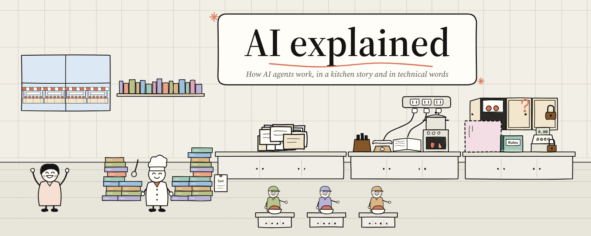
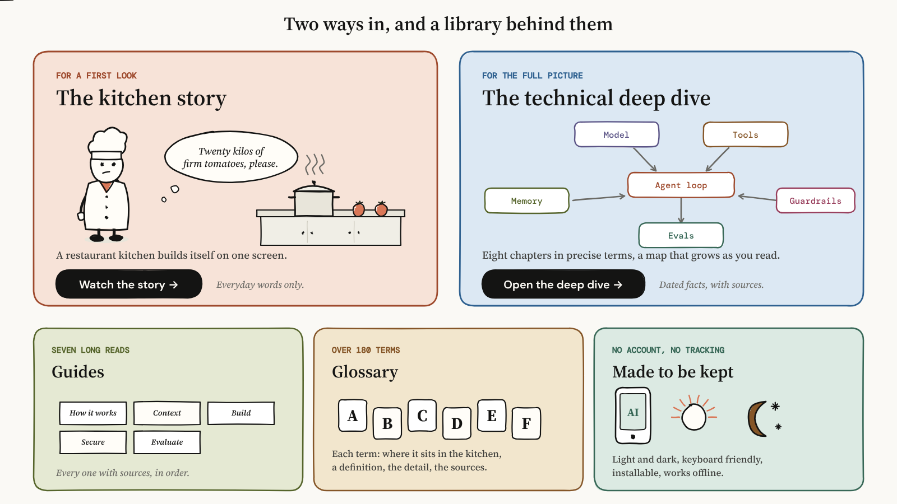
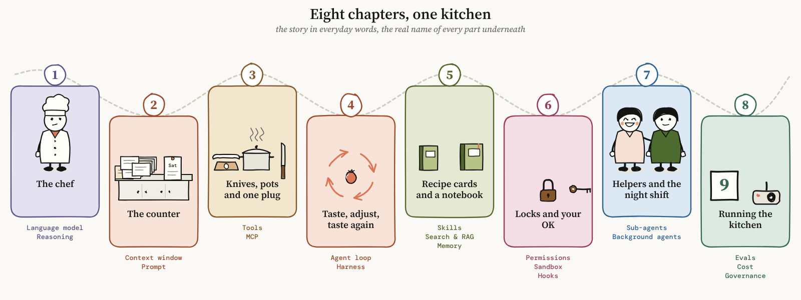
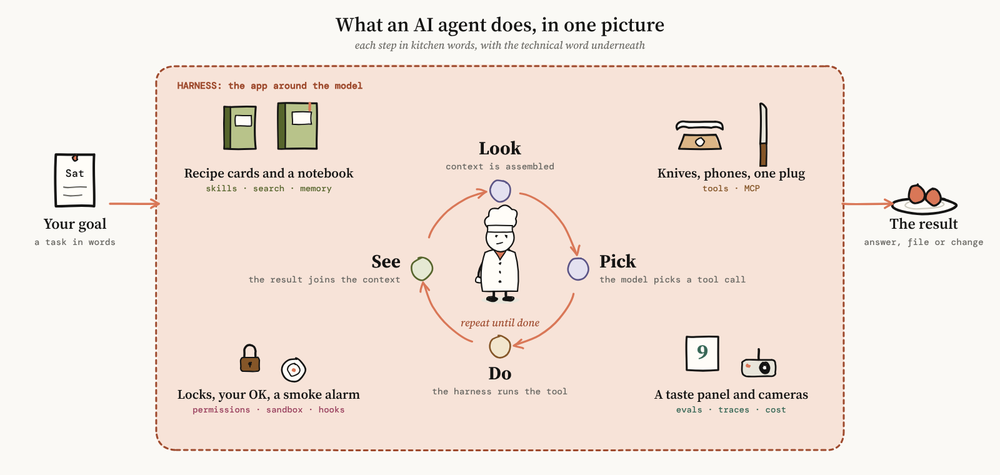
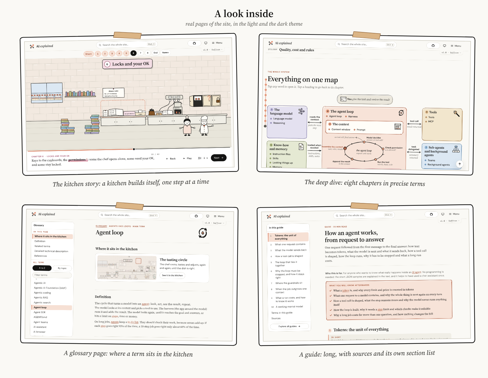

<h1 align="center">AI explained</h1>

<p align="center">
  <picture>
    <source media="(prefers-color-scheme: dark)" srcset="docs/readme/banner-dark.png">
    
  </picture>
</p>

<p align="center">
  <strong>How AI agents work, for people who are new to it and people who build with it.</strong><br>
  A free, static website. No account, no cookies, no tracking.
</p>

<p align="center">
  <a href="https://veniplex.github.io/ai-explained/"><strong>Open the site</strong></a> ·
  <a href="https://veniplex.github.io/ai-explained/story/">Kitchen story</a> ·
  <a href="https://veniplex.github.io/ai-explained/technical/">Deep dive</a> ·
  <a href="https://veniplex.github.io/ai-explained/guides/">Guides</a> ·
  <a href="https://veniplex.github.io/ai-explained/glossary/">Glossary</a>
</p>

<p align="center"><sub>Release 1.0 · facts as of October 2026</sub></p>

---

## Two ways to read the same topic

An AI agent is a language model that can look, decide, do something and look again, until the job is done. That is easy to say and hard to picture. So the site tells it twice.

<picture>
  <source media="(prefers-color-scheme: dark)" srcset="docs/readme/ways-dark.png">
  
</picture>

- **The kitchen story** is one hand-drawn restaurant kitchen on a single screen, with nothing to scroll. It builds itself piece by piece while the chef walks to where the next thing happens: the chef is the model, the counter is the context, the knives and pots are tools. In the last chapter the real names are laid over the faded kitchen, and each one opens a card.
- **The technical deep dive** tells the same eight chapters in technical words with no analogy: the mechanisms, the details, dated facts and checked sources, next to a map that grows as you read.

Pick the one that suits you. Nothing in the deep dive needs the story, and the other way round.

## Eight chapters, one agent

<picture>
  <source media="(prefers-color-scheme: dark)" srcset="docs/readme/chapters-dark.png">
  
</picture>

The heart of every agent is a small loop, and most of the rest is what you put around it:

<picture>
  <source media="(prefers-color-scheme: dark)" srcset="docs/readme/loop-dark.png">
  
</picture>

The model **looks** at what is on the counter, **picks** a next step, **does** it with a tool and **sees** what came back. The harness around it decides what the model may see, what it may touch and when it has to ask you.

## What is inside

<picture>
  <source media="(prefers-color-scheme: dark)" srcset="docs/readme/screens-dark.png">
  
</picture>

| | |
| --- | --- |
| **Kitchen story** | One screen, 62 steps. Click, arrow keys, swipe, a scrubber, the dots of each chapter, or Play at your own speed. |
| **Technical deep dive** | Eight chapters and a map of 21 main terms, each with a page of its own. |
| **Glossary** | 187 terms, each with an icon, a definition, related terms, a detailed technical description, references and a drawing of where it sits in the kitchen. A to Z or by topic. |
| **Guides** | Seven long articles for people who build: how an agent works, context engineering, building an agent, securing agents, testing and running them, what is easily confused, where to learn more. Every claim points to a numbered source. |
| **Search** | Press `/` or Ctrl/Cmd+K and a search window floats over the page: glossary, chapters and guides. Arrow keys choose, Enter opens, Esc closes. |
| **Always oriented** | On long pages the heading of the part you are reading stays pinned under the top bar, so you always see where you are. |
| **Hover cards** | Rest on any term for a short explanation and a link to its page. |
| **Themes** | Light, dark or follow the device. |
| **Offline** | Install it as an app (Chromium browsers; Share, then Add to Home Screen on iPhone and iPad) and it works without a network. |
| **Accessible** | Works with the keyboard alone, respects reduced motion, and gives touch targets enough room on phones and tablets. |

Every fact is dated and sourced, primary sources first: vendor documentation, specifications, standards bodies, and then the papers that started things.

## Run it yourself

There is no build step and no package manager. Any static server will do:

```sh
git clone https://github.com/veniplex/ai-explained.git
cd ai-explained
python3 -m http.server 8000
# then open http://localhost:8000/
```

Node 18 or newer is only needed for the checks.

```sh
node scripts/check-site.js        # content, links, sources, generated files, privacy rules
node --test scripts/*.test.js     # tests of the checkers, the version list and the old addresses
node scripts/build-pages.js       # regenerate the glossary, guide and about pages after editing the shell or the term list
```

How the pieces fit together is written down in [docs/how-it-is-built.md](docs/how-it-is-built.md).

## Releases and older versions

The root of this repository is the current release, **1.0**. It is what the address `veniplex.github.io/ai-explained/` shows.

The site grew through sixteen earlier alpha versions: a first interactive map, a guided path, side-by-side voices, a comic, a growing storyline, and finally the kitchen on one screen. They are kept, unchanged, in [`versions/`](versions/) and stay online at `…/ai-explained/versions/<name>/`. Old addresses such as `…/v0.12-alpha/` still work: they forward to the new place.

Every page has a version dropdown in its top bar. It lists all releases by number and codename (v1.0 is Vaswani, named after the last name of a researcher whose work shaped AI; the older versions run back through history to Lovelace), with the current one marked, and takes you to the same page in another release when that page exists there. The list lives in one file, [`versions/versions.js`](versions/versions.js).

## How it is made

- Plain HTML, CSS and JavaScript. No framework, no bundler, no CDN, no web fonts, no analytics.
- The drawings are made in the browser with [rough.js](https://roughjs.com/) and the site's own pen (`assets/js/draw.js`) and drawings (`assets/js/props.js`). The pictures in this README were drawn with the same pen.
- The only request the site makes to anyone else is the star count in the GitHub button (GitHub's public API, no cookies, hidden if it fails).
- It is published with GitHub Pages from the root of the `main` branch by [`.github/workflows/pages.yml`](.github/workflows/pages.yml).

## Credits

- [rough.js](https://github.com/rough-stuff/rough) by Preet Shihn, MIT licence (copy in `assets/vendor/`).
- Fonts DM Sans, DM Mono and Source Serif 4 by their project authors, under the SIL Open Font Licence (copies in `assets/fonts/`). They are self-hosted.
- The sources behind every claim are linked on the pages themselves.

## Licence

[Creative Commons Attribution-NonCommercial 4.0](LICENSE) (CC BY-NC 4.0): you may share and adapt everything here, with credit to the project ("AI explained" and a link to this repository), but not for commercial purposes. The third-party files in `assets/vendor/` and `assets/fonts/` keep their own licences.

## Contributing

Corrections are welcome, especially facts that have gone out of date. Open an issue or a pull request, and run `node scripts/check-site.js` first. Please keep personal information out of anything you submit: this repository is public.
